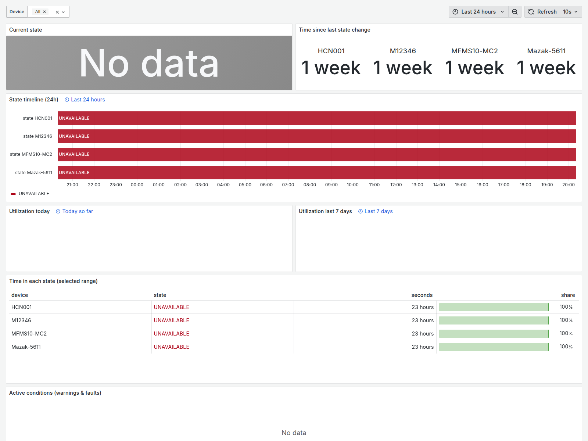

# MTConnect-Demo

MTConnect-Demo is a Python logger (`mtc_logger`) that polls MTConnect agents, stores machine state and faults in Postgres or SQLite, and shows utilization on a Grafana dashboard, so a shop can keep a history of what a machine was doing instead of only the live agent page. The default sources are Mazak's public demo agents at [mtconnect.mazakcorp.com](http://mtconnect.mazakcorp.com/), not a customer site; this is a demo, with no claim about those agents' uptime and no trademark implication for Mazak or MTConnect.

## Quick start (Postgres + Grafana)

    cp .env.example .env            # then set POSTGRES_PASSWORD and GRAFANA_ADMIN_PASSWORD
    docker compose up -d            # Postgres 16.9 + Grafana 11.6.1; wait for "healthy" in `docker compose ps`

    python3 -m venv .venv && .venv/bin/pip install -r requirements.txt
    .venv/bin/python mtc_logger.py run --backfill --poll-seconds 10 \
        --db-url postgresql://mtc:<POSTGRES_PASSWORD>@localhost:5434/mtc \
        --source http://mtconnect.mazakcorp.com:5719,HCN001 \
        --source http://mtconnect.mazakcorp.com:5611,Mazak,Mazak-5611 \
        --source http://mtconnect.mazakcorp.com:5610,MFMS10-MC2 \
        --source http://mtconnect.mazakcorp.com:5717,M12346

`--backfill` makes the first poll also read the history each agent still buffers, so the dashboard has something to show right away. Use it on the first run only; it is not needed to resume.

Those `--source` URLs are Mazak's public demo agents (one agent per port, one device each). What each port was doing when it was last checked is in [Notes from the demo agents](#notes-from-the-demo-agents). Without `--source`, `run` logs `--device` (default `HCN001`) from `--agent-url` (default `http://mtconnect.mazakcorp.com:5719`). `--source URL,DEVICE[,LABEL]` is repeatable; LABEL is the name stored in the database, so two agents that both call their device `Mazak` can be kept apart.

Open http://localhost:3000 (login: `GRAFANA_ADMIN_USER` / `GRAFANA_ADMIN_PASSWORD` from `.env`), dashboard **Machine Status**. The logger runs on the host, not in a container. To keep the password out of shell history: `export MTC_DB_URL=postgresql://...` and drop `--db-url`.

Ports are bound to 127.0.0.1 (Postgres host port `POSTGRES_PORT`, default 5434, because 5432 is often taken). Data lives in named volumes `pgdata` / `grafana-data`; `docker compose down -v` deletes them.

**Changed a password in `.env` after the first `docker compose up`?** It is ignored: both passwords are only applied when the volume is first created, so logins fail. Either `docker compose down -v` (wipes all data), or sync in place:

    set -a; . ./.env; set +a
    docker compose exec -T grafana sh -c 'grafana cli admin reset-admin-password "$GF_SECURITY_ADMIN_PASSWORD"'
    docker compose exec -T db sh -c 'echo "ALTER USER \"$POSTGRES_USER\" PASSWORD :'"'"'pw'"'"';" | psql -U "$POSTGRES_USER" -d "$POSTGRES_DB" -v pw="$POSTGRES_PASSWORD"'
    docker compose restart grafana

## SQLite only (no Docker)

    .venv/bin/python mtc_logger.py run [--db mtc.db] [--device A --device B] [--agent-url URL] [--poll-seconds 2]
    .venv/bin/python mtc_logger.py report [--db mtc.db] [--device A] [--since ISO] [--until ISO]
    .venv/bin/pytest

Flags can go before or after the subcommand. `--db` and `--db-url` are mutually exclusive; an explicit flag always beats `MTC_DB_URL`. `report` with no `--device` reports every device in the DB. Same tests against Postgres: `MTC_TEST_PG_URL=postgresql://... pytest` (touches only device `X`).

## Code layout

The project is MTConnect-Demo. The command is `mtc_logger.py`; the library package is `mtc`.

    mtc_logger.py       entry point (thin)
    mtc/
      cli.py            argument parsing, wires the pieces together
      collector.py      polling loop: the only place that talks to agents (HTTP) and writes to the DB
      parsing.py        XML -> Snapshot            (pure)
      tracker.py        what changed? markers      (pure)
      intervals.py      interval/utilization math  (pure)
      report.py         prints the report
      storage.py        Postgres / SQLite access
      models.py, states.py, timeutil.py   small shared pieces
    sql/                schema (postgres.sql, sqlite.sql)
    tests/              pytest, incl. a fake local agent
    grafana/            provisioned datasource + dashboard

Conventions for changing the code are in `DEVELOPMENT.md`.

## How it talks to the agent

Follows the MTConnect client pattern ([docs](https://mtconnect.mintlify.app/concepts/streams-and-samples)):

1. `GET /{device}/current` once, to learn the tracked data item ids and the header's `nextSequence`.
2. Every poll after that: `GET /{device}/sample?from=<nextSequence>&count=1000&path=//DataItem[@id="..."]|...`. Every change since the last poll arrives in order, so a state that flips and flips back between polls is not lost, and the `path` filter keeps responses small (Mazak: ~0.6 KB per poll instead of ~105 KB).
3. `instanceId` changed (agent restarted) -> sequence numbers are invalid -> back to step 1, `AGENT_RESTART` marker.
4. `OUT_OF_RANGE` (our position fell out of the agent's buffer) -> observations were lost -> `DATA_GAP` marker, back to step 1.
5. Request failed -> `UNAVAILABLE` marker (once), back to step 1 when the agent answers again.

Not used: streaming (`interval=`); polling is simpler and `--poll-seconds` bounds latency.

## Storage

- `observations` (id, ts, device, data_item_id, type, value, instance_id, sub_type) holds every logged change for any tracked MTConnect element. Postgres `ts` is `timestamptz`; SQLite `ts` is ISO text.
- `sub_type` (e.g. `x:CUT`) identifies what an item is when ids differ between agents (`cut_time` vs `ctime`). Databases from before it existed get the column added on connect; older rows have NULL.
- Views: `events` (id, ts, device, state, instance_id) = the Execution rows (the original schema, so the dashboard and `report` are unchanged), and `state_intervals` (device, state, start_ts, end_ts, duration_seconds; the open interval ends at now()).
- Choose what to log with `--track` (repeatable): MTConnect element names such as `Execution`, `Program`, `PartCount`, plus `Condition` for warnings/faults. Default is a set of low-rate state items (see `DEFAULT_TRACKED` in `mtc/cli.py`): Execution, Condition, ControllerMode, EmergencyStop, DoorState, ToolNumber, PartCount, Program, WorkOffset, overrides, EquipmentMode, AccumulatedTime, Temperature, RotaryVelocity. High-rate items (axis feedrates, line numbers, positions, loads) are deliberately not logged. Only `Execution` feeds `events`/utilization.
- `conditions` (id, ts, device, data_item_id, type, level, native_code, severity, qualifier, message, instance_id) stores each WARNING/FAULT when it starts and the NORMAL/UNAVAILABLE that clears it (matched by native code; a Normal with no code clears the whole data item). Baseline Normals and repeated reports are not stored. Views: `condition_intervals` (start_ts, end_ts; end_ts is NULL while active) and `active_conditions`. After an outage, restart or buffer wrap, conditions the agent no longer lists are closed at the poll time. Faults on the Mazak agents last about a second.
- Outages, agent restarts and lost observations write an `UNAVAILABLE` / `AGENT_RESTART` / `DATA_GAP` marker for every item already seen for the device. A device that was never reached has nothing to mark. All three are excluded from the utilization denominator. Markers are stamped with the local poll time, and so is the first value after one (agents stamp an unchanged state with when it began, which would otherwise sort before the marker). Keep clocks in sync.
- Upgrading from the old single `events` table: the first connect copies its rows into `observations` and renames the old table to `events_legacy` (kept as a backup). Copied rows use the placeholder `data_item_id` `execution`; if the device's real id differs (e.g. `Lpexecution`), relabel with `UPDATE observations SET data_item_id='<real id>' WHERE device='<d>' AND data_item_id='execution'`.
- The MTConnect docs this collector follows don't specify error codes; `OUT_OF_RANGE` and `INVALID_XPATH` were confirmed against a real agent (HTTP 400 + `MTConnectError`). A device with several Execution items (multi-path) would interleave them in `events`.
- Schema is in `sql/` (Postgres file is also mounted into the container and applied by the logger on connect).

## Dashboard panels

Beyond utilization (all from the logged data; the Device variable and time picker apply):

- **Machine snapshot** - latest state, mode, program, tool, work offset, door, e-stop, part count, spindle rpm per device.
- **Powered-on time, in-cycle share, cutting share, and minutes per hour** - from the machine's own accumulated-time counters (sub types `x:TOTAL`, `x:AUTO`, `x:CUT`), via the `accumulated_time_hourly` view (Postgres only). Counters are on the Mazak v1.4 agents; HCN001 (v2.3) does not report them. `total_time` updates about every 2 minutes, so shares are approximate on short ranges.
- **Why did it stop?** - every FEED_HOLD / INTERRUPTED / STOPPED interval with conditions from the previous 5 minutes and whether the door was opened.
- **Tool changes**, **Operator activity** (door, overrides, mode, e-stop), **Temperatures**, **Spindle speed**.
- Plus the earlier state timeline, utilization, time-in-state, and condition panels.

## Alerts

`grafana/provisioning/alerting/rules.yml` provisions one rule, **Machine fault in the last 5 minutes** (per device, checked every minute, from `condition_intervals`; it looks at recent history because faults can be shorter than the check interval). Grafana only shows it as firing until you add somewhere to send it: in Grafana go to Alerting > Contact points, add Slack, email (needs SMTP set up) or a webhook, and point the default notification policy at it. That is not provisioned because it needs your address/webhook secret.

## Dashboard notes

- Provisioned from `grafana/`. Edit the JSON in `grafana/dashboards/mtc.json` (UI edits are not persisted).
- "Utilization today" uses the browser's timezone for midnight; "last 7 days" and the 24h timeline ignore the time picker by design (panel time overrides). Other panels follow the time picker. The Device variable filters all panels.
- In SQL, utilization = ACTIVE / (logged non-UNAVAILABLE/AGENT_RESTART time in range). Time before a device's first event is not counted (the CLI's explicit `--since` before the first event does count it).

## Semantics

- `events(ts, device, state, instance_id)`; a row is written only on state change; restarts resume from the last stored state.
- `ts` is the observation's own timestamp. Exception: UNAVAILABLE rows from network/HTTP errors use the local clock (there is no observation).
- Header `instanceId` change inserts an `AGENT_RESTART` marker, then the current state.
- Utilization = ACTIVE / (window − UNAVAILABLE − AGENT_RESTART − DATA_GAP).
- Report intervals are clipped to the window; the state in effect at `--since` counts.

## Notes from the demo agents

The quick start points at Mazak's public demo agents ([mtconnect.mazakcorp.com](http://mtconnect.mazakcorp.com/), one agent per port, one device each).

Checked on Nov 24, 2026: ports 5719 (`HCN001`, agent 2.3.0.7), 5611 (`Mazak`, 1.4.0.12), 5610 (`MFMS10-MC2`, 1.4.0.12), and 5717 (`M12346`, 1.8.0.3) all answered `/probe` and `/{device}/current`. On each current, machine values such as Execution, program, part count, and e-stop were `UNAVAILABLE`, timestamped 2026-11-16T07:43:58Z. The agents answered; they were not reporting a live machine. 5610 and 5611 share that timestamp exactly; 5719 and 5717 differ by a fraction of a second, and the sequence counts differ. `5719`'s `/current` used the streams namespace `urn:mtconnect.org:MTConnectStreams:2.0`.

An earlier pass (Oct 2026) saw 5719, 5611, and 5610 up and mirroring one machine (identical timestamps and cumulative counters, so the same data three times), and treated 5717 as down since Sep 16. That is not what the Nov 24 check showed.

From an earlier look at demo-agent output:

- Namespace on that look was `urn:mtconnect.org:MTConnectStreams:2.8`; parsing by local name works regardless.
- `<Execution dataItemId=… timestamp=…>ACTIVE</Execution>`. dataItemIds differ per device: `Lpexecution` (OKUMA, also has `name="pexecution"`), `execution` (Mazak). The probe lists both, but each device's `/current` has only one, so I take the first Execution element.
- The Execution timestamp is when the state *began*, not poll time (e.g. 2 minutes old). Good for event time. Availability's timestamp was 5 days old.
- Header `instanceId` is a plain integer (the same number on the agents checked Nov 24, 2026). `/current` also has `nextSequence`, `firstSequence`, and `lastSequence`; the collector uses them to continue with `/sample`.
- That earlier probe was described as MTConnect 2.8, and the demo agent had `Agent` / `Adapter` pseudo-devices too. On Nov 24, 2026 the device-document namespaces were 2.0 (5719), 1.7 (5717), 1.4 (5611), and 1.3 (5610); 5719 and 5717 still expose `Agent` / `Adapter` entries.
- The demo's Execution barely changed in ~4 minutes, so the demo run logged one row and 100% utilization. Error/restart/resume paths were verified against a throwaway local fake agent, not the demo.
- Restart and gap time is treated as unknown, the same as UNAVAILABLE (the spec only named UNAVAILABLE; this is my choice).

## Limitations

- While polls succeed, a value that flips and flips back between polls is stored. The first poll reads `/current`, and every poll after that continues with `/sample?from=<nextSequence>`. Changes are still missing in three cases. The first poll stores only the current value unless `--backfill` is set, and then only what the agent still has in its buffer. A failed poll resyncs from `/current` and does not replay that buffer, so transitions during the outage are not stored: an `UNAVAILABLE` marker is written, then the value `/current` reports. If the buffer wraps past our sequence (`OUT_OF_RANGE`), those observations are gone and a `DATA_GAP` marker is written.
- Local-clock UNAVAILABLE timestamps mix with agent-clock timestamps; keep clocks synced.

## License

MIT. Copyright (c) 2026 Genesee Software Co. LLC. See `LICENSE`.
